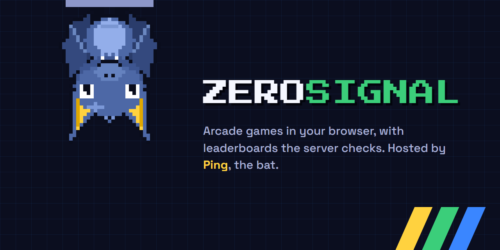
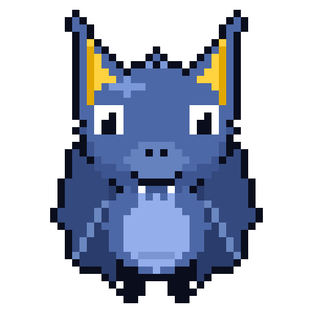

<p align="center">
  
</p>

# Zero Signal

A hub of fun browser games with a retro arcade UI and real, **server-verified leaderboards** (clients cannot cheat).

- **Frontend:** React + TypeScript + Vite
- **Backend:** Rust + Axum + sqlx
- **Database:** PostgreSQL 16

## Meet Ping



**Ping** is Zero Signal's official mascot and logo: a small bat, because bats find their way by sending out a signal and listening for the echo. He is pixel art drawn in code (no image files; see `frontend/src/mascot/`), and he hangs upside down beside the ZERO SIGNAL wordmark on every page.

- **Idles on his own:** swings, sends a sonar ping, stretches his wings with a yawn, looks around, and his eyes follow your pointer. During a game he keeps quiet and only blinks.
- **Click him** for a trick (a flap, a loop or an echo, never the same twice in a row) with a line in a speech bubble; **press and hold** to pet him (hearts); poke him five times fast and he gets dizzy.
- Follows **reduced motion** (he stays still but still talks), and his squeaks follow the menu-sounds volume.
- His head is the browser-tab icon and the home-screen icon, and he is on the link preview when the site is shared. Brand images: `docs/brand/` (`ping.svg`, `ping.png`, `ping-hanging.png`, `social-preview.png`).

## Games

| Game         | Status      | Notes |
|--------------|-------------|-------|
| Sling Squad   | Live        | 12 levels in 3 worlds with stars; full physics; the server re-simulates every shot with `rapier2d` |
| Connect Four | Live        | vs AI (4 levels) or vs a friend; best of 3/5; 14 chip skins (6 free) + spin wheel |
| Tic-Tac-Toe  | Live        | vs AI (Easy, Medium, unbeatable Hard) or vs a friend; boards, faces, your photo as a face |
| Whack-a-Mole | Live        | 5 modes (a calmer Normal, Classic, Frenzy, Survival, Daily), 6 kinds of moles, combos and FEVER; the server replays every tap |
| Minefield    | Live        | No-guess boards in 3 sizes + a Daily; the server keeps the mines |
| 2048         | Live        | Classic 4×4, Big 5×5, Tiny 3×3 + a Daily; saved as you play; the server replays every move |
| Chess        | Live        | vs Zero-Bot (4 levels), online vs a friend, same device, a Daily "mate in 2"; 12 boards and 8 piece sets |
| Sonar        | Live        | Battleship-style with sonar pings and a power for every ship (plus mines and crates): vs Zero-Bot (4 levels), a 12-mission Campaign, a Ship Workshop, online, same device and a Daily Hunt; 8 fleets and 8 seas |
| Snake Signal | Live        | Neon snake: Classic, Wrap and a Daily on 3 board sizes; power-ups, glitch hazards, ×5 combos and a fading signal; 8 skins, 8 arenas, 6 trails; the server replays every turn |
| Checkers     | Live        | Classic 8×8 draughts: vs Zero-Bot (4 levels), online vs a friend on another device, same device and a Daily "win in 2–4" puzzle; 8 boards and 8 piece sets |
| Sudoku       | Live        | Classic 9×9 in 4 levels + a Daily; every puzzle has one solution and needs no guessing; notes, hints with reasons, Check when the grid is full; 8 board themes |
| Memory Match | Live        | Online only: take turns flipping pairs with a friend on 4×4, 4×6 or 6×6; Chaos mode adds 10 confusing power-ups (bring 3) |
| Brick Breaker | Live       | A 24-level Campaign in 2 worlds (stars = lives left), Endless waves and a Daily; tough, steel, explosive and moving bricks; 6 drops; 32 cosmetics; the server replays every paddle move |
| Signal Flap  | Live        | One button: fly a signal drone through the gaps in antenna towers, picking up signal bars; gaps narrow, speed up and slide the farther you go; Endless and a Daily; 24 cosmetics; the server replays every flap |
| 3 more       | Coming soon | Pixel Picross, Block Drop, Pong Online (see `/roadmap`) |

## Features

- Register / login (Argon2 password hashing + JWT auth). **Anyone can play without an account** (see Guest play below); an account is needed to get on the leaderboards and to use the shop, wardrobe, daily login reward and quest/achievement claims.
- **Guest play:** opening a game without an account quietly starts a **guest account** in the background (kept in that browser; deleted after 30 days without a visit). Guests earn coins, XP, tokens, quest progress and items like anyone, but are hidden from leaderboards, weekly prizes and profiles. A slim banner and a "Register to save this score" button on every results screen remind them. **Registering** turns the guest into the real account, so everything is kept. **Logging in** to an existing account moves the guest's scores, games, items and earlier quest days into it, and pays the guest's coins, tokens and XP as a normal reward (coins count toward the 1,000-a-day cap); where both have something (today's quests, an unfinished game, today's Daily) the account's wins. At most 20 new guests per hour per IP; guests can't log in with a password, and usernames can't start with "guest".
- **Hub:** logged out, a short intro with Create account / Log in / Quick play. Logged in, a welcome strip (your character, level and XP bar, coins, **Continue** your last game, Stats and Achievements shortcuts), **Recently played** (last 3 games, remembered in this browser) and **Today's quests** side by side, then every game with your best score. **Filter chips** (All · 🌐 Online · 👤 Offline, with counts, remembered in the browser; Online = the games you can play with a friend, on another device or the same one; Offline = the games you play on your own) narrow the list, and every card shows **play badges** saying how it can be played (Online = a friend on another device with a room code).
- Per-game leaderboards and personal history, with **All time / This week / Last week** views. Weeks run Monday 00:00 → Monday 00:00 WIB.
- **Weekly prizes:** the top 3 last week on each board (Sling Squad, Connect Four, Tic-Tac-Toe, each Whack-a-Mole mode, each Minefield size, each Sudoku level; not the Daily boards) claim 150 coins + 1 token, 100 or 50 coins from a banner on the Hub or Leaderboards. Best-score games rank by the week's best score; Connect Four and Tic-Tac-Toe by points earned that week. Prize coins don't count toward the daily cap.
- Anti-cheat by design: clients send only player *inputs*; the server computes every score.
- **10 free mood themes** (Settings → Appearance): Neon Arcade, Daylight, Sunset Chill, Sakura, Ocean Calm, Midnight Focus, Forest, Game Boy Green, Cyberpunk and Candy Pop. They come in light/dark pairs of the same mood, so the 🌙/☀️ button flips to the partner; every theme keeps text at WCAG AA contrast (checked by a test), and the choice syncs to your account.
- The Hub shows **4 games per row** (2 on tablets, 1 on phones), and every page has the same big, labelled **← Back** button at the top left.
- **Settings** open full-screen over whatever you're doing (a game keeps running underneath; Esc or ✕ closes). A sidebar lists the sections (Appearance · Sound · Gameplay · Controls · Privacy · Account), each setting is one row with a short explanation and its switch or picker on the right, a **search box** finds any setting (press /), each section has its own **Reset this section**, and Appearance shows a **live preview** of your theme, text size and contrast. On phones the section list comes first and you tap into a section. Registered players' settings (and theme) are **saved to the account** and follow them to every device (the account's copy wins on login); guests' stay in the browser.
  - **Display:** high contrast (plain black/white, bright borders), readable font (replaces the pixel font), fullscreen, FPS counter, light graphics, colorblind-friendly, reduced motion (also follows your device setting), screen shake, text size S/M/L/XL.
  - **Controls:** shortcut keys on every page (**M** mute everything, **F** fullscreen, **Esc** close a window / pause Whack-a-Mole, Snake Signal, Brick Breaker or Signal Flap; a game that uses the same key keeps it), with a switch to turn them off, and **every game's keys can be changed**: click ✕ to remove a key or **+ Key** and press a new one (up to 4 per action), with a warning when two actions share a key and a **Reset keys** button per game. Changed keys are part of the synced settings. Connect Four (1–7 drop in a column) and Tic-Tac-Toe (numpad layout, 7 8 9 = top row) can be played by keyboard too.
  - **Sound and music:** on/off and volume for each, plus a separate **menu sounds** volume for button clicks.
  - **Privacy:** **hide me on leaderboards** (you still earn everything, but get no weekly prizes) and **private profile** (your page shows only your name). **Pop-ups:** switch off the daily-login pop-up (claim from the 🎁 button on the Hub instead), the level-up pop-up and the reward toasts separately.
  - **Gameplay:** turn timer, **ask before leaving a round** (warns before closing the tab or opening another page mid-round in Whack-a-Mole, Snake Signal, Brick Breaker, Signal Flap, Sling Squad and Minefield), vibration on phones.
  - **Help:** reset tutorials so every "how to play" shows again.
  - **Account** (registered players): change username (free, once every 30 days), email and password (both need your current password), and **delete account**: you're signed out and hidden at once, and the account is deleted for good after 7 days unless you log in again before then.
- **Stats page** (`/stats`): your level, coins earned and spent, tokens, login streak, quests and achievements, plus a card per game: AI series win rates per level, best and average scores per mode or size, Minefield and Sudoku best times, Whack-a-Mole best combo and FEVER rounds, 2048 biggest tile and games that reached 2048. Only server-verified results count.
- **Colorblind-friendly** switch (Settings → Appearance): pieces switch to the Okabe-Ito palette, which people with common color vision deficiencies can tell apart, and get shapes so no game relies on color alone. In Connect Four, player 1's chips carry a circle and player 2's a cross. In Tic-Tac-Toe, X and O get safe colors and other faces get an X or O badge. Winning lines also get a dashed outline.
- **Tutorials:** each live game shows a short 4-step "how to play" the first time you open it. The **?** button (bottom-left) shows it again. Seen tutorials are remembered in the browser.
- Background music: 3 chiptune tracks made in code with Web Audio (no music files). "Insert Coin" plays on the hub and menus, "Quiet Board" in Connect Four and Tic-Tac-Toe, and "Slingshot Rush" in Sling Squad. Music has its own on/off switch and volume (default on at 40%). It starts after your first click or key press, because browsers block autoplay, and it pauses while the tab is hidden.
- Shared economy: every server-verified game pays **coins**, **XP** (levels) and sometimes a lucky **token**.

## Tic-Tac-Toe

- **Modes:** vs AI or a friend on one device. You (X) always move first.
- **AI:** Easy (mostly random), Medium (always blocks, but slips up), **Hard (perfect play, can never lose)**. A test checks every possible human strategy against Hard.
- **Series:** best of 3 or 5 games, and draws count as games. A series ends early once one side can't be caught; equal wins at the end means the series is drawn.
- **Rewards (AI only):** XP every game. Winning a series pays Easy 5 / Medium 15 / Hard 40 coins. A drawn series against Hard pays 15 coins, because surviving it is the achievement. Best of 5 pays double. Token chance 8% / 15% / 50% (15% for a drawn Hard series).
- **Undo:** max 3 per game, none on Hard. Using undo cancels the series' reward spin.
- **Boards and faces:** 6 boards and 12 faces (X/O, emojis, Sling Squad chips, your character's face, your photo), listed in `shared/tic_tac_toe_items.json`. Buy them with coins or win them on the reward spin, which never gives a duplicate.
- **Photo face:** upload a picture or use your webcam, then drag and zoom to crop it to a circle. The browser shrinks it to 128×128 before upload, and the server only accepts real JPEG/PNG/WebP files up to 64 KB. Your photo is **private**: only you can load it, and it's deleted with your account.

## Whack-a-Mole

- **Modes:** Classic (60 s, speeds up), Frenzy (30 s, faster moles, more at once), Survival (no clock, 3 lives, gets faster, ends at 5 min), Daily Challenge (Classic rules on 3×3, the same moles for everyone that WIB day, with a Today leaderboard).
- **Board:** 3×3, or 4×4 for ×1.2 points. Mouse, touch or keyboard: 3×3 uses the numpad layout (7 8 9 / 4 5 6 / 1 2 3) or Q W E / A S D / Z X C; 4×4 uses 1 2 3 4 / Q W E R / A S D F / Z X C V. "Show keyboard keys" prints them in the holes.

| Mole | Points | What it does |
|------|--------|--------------|
| Mole | 100 | |
| Ninja | 150 | pops up only briefly |
| Helmet | 250 | needs 2 hits (the helmet cracks first) |
| Golden | 500 | rare |
| Ice | 50 | +3 s on timed modes (max +15 s), +1 life in Survival |
| Bomb | −300 | don't hit it; in Survival it costs a life |
| Double (power-up) | 50 | ×2 points for 6 s |
| Shield (power-up) | 50 | forgives your next combo-breaker (holds up to 2) |
| Slow-mo (power-up) | 50 | the game clock runs at half speed for 5 s |
| **Boss** | 50 per hit + 1,000 | comes up every 20 s (Frenzy 12 s, Survival 30 s), stays 3.5 s, takes 8 hits |

- **Combo:** 5 hits in a row pay ×1.5, 10 in a row start **FEVER ×3** (the board glows). A tap on an empty hole, a bomb, or an escaped mole ends it. In Survival every escaped mole (not golden or ice) costs a life.
- Every mole kind has its own shape (mask, hard hat, crown, ice block, skull bomb), so color is never needed.
- **Results:** accuracy, average reaction time, best combo, moles per kind and a heat map of the holes.
- **Anti-cheat:** `start` gives the client a run id and a seed; client and server build the same mole schedule from it (same 32-bit integer code in `engine.ts` and `engine.rs`, checked by shared test vectors). The client sends only its taps `(ms, hole)`; the server replays them, rejects rounds that finished faster than real time, and computes the score. Each run can be finished once, within 15 minutes.
- Pausing (or switching tabs) stops the game clock.
- **Hammers** (cursor, hit sound and spark): Wooden Mallet (free), Squeaky Toy 150, Frying Pan 250, Wet Fish 250, Neon Ban-Hammer 600, Golden Hammer 1,500.
- **Board themes** (board, holes, mole colors): Garden (free), Neon Arcade 300, Graveyard 400, Sunny Beach 400, Deep Space 1,200. Catalog: `shared/whack_items.json`.
- Locked items are bought with coins on the setup screen, or **drop by luck**: a round scoring 3,000+ has a 5% chance to give one you don't own. The server checks you own the hammer and theme when a round starts.
- **Your character** stands beside the board and reacts to FEVER, bombs and boss knock-outs.

## Minefield

- **Boards:** Beginner 9×9 / 10 mines, Intermediate 16×16 / 40, Expert 16×30 / 99, and the **Daily** (Intermediate size, the same board for everyone that WIB day, already opened in the middle, one ranked try, the clock starts when it opens).
- **No guessing, ever:** the board is made on your first click. The server keeps only boards its logic solver (single-cell, subset and mine-count rules) can clear from that click, so there is never a 50/50.
- **Server holds the mines:** the client sends the cell it opens and gets back only opened cells. Mines are sent only after the game ends, so peeking is impossible.
- **Controls:** click opens; right-click or long-press cycles flag → ? → none; **Flag mode** for touch; click (or middle-click) a number whose flags are placed to open around it (chording). Keyboard: arrows move, Space/Enter open or chord, F flags.
- **Hints:** up to 3 per game. Each opens a safe cell next to what you've opened and adds 20 s.
- **Score (wins only):** Beginner 1,000 + 20 per second under 60 s; Intermediate and Daily 3,000 + 15 per second under 240 s; Expert 8,000 + 12 per second under 600 s. One leaderboard per size plus Today's Daily.
- **Results:** time, 3BV (fewest clicks that clear the board), 3BV/s, click efficiency, hints. A loss shows every mine and crosses out wrong flags.
- **Rewards:** win Beginner 5 / Intermediate 20 / Expert 60 / Daily 25 coins; XP 20 × (1 / 2 / 4 / 2); token 2% / 8% / 25% / 10%. A loss gives 5 XP.

## Sudoku

- **Levels:** Easy (~40 numbers given), Medium (~32), Hard (~27) and Expert (~26) on the classic 9×9, plus the **Daily** (a Medium puzzle, the same for everyone that WIB day, one try).
- **Fair puzzles:** every puzzle has exactly one solution and is graded by the logic a person needs, never a guess: Easy needs only naked singles, Medium adds hidden singles, Hard adds locked candidates and naked / hidden pairs, Expert adds triples and X-Wings. They come from a bank made offline (`cargo test --release sudoku_make_bank -- --ignored` writes `backend/data/sudoku_puzzles.json`, which stays on the server).
- **Server holds the solution:** the browser gets only the printed numbers; the solution is sent after the game ends. The clock is the server's. Your grid is saved as you play, so a game continues after a reload or on another device; notes stay in that browser.
- **No checking until it's full:** fill the grid freely. When every square has a number, press **Check**: wrong squares turn red and the clock keeps running until you fix them.
- **Helpers:** **Notes** (small pencil numbers; placing a number clears it from the notes in its row, column and box), **highlights** (the row, column and box of the selected square, the same number elsewhere, a number used 9 times greys out on the pad, and a number that repeats in a row, column or box shows red; they only compare what's on screen, never the solution) and up to 3 **hints** per game: each fills the next square you could work out and says why ("1 is the only number that fits"), +30 s. No undo.
- **Controls:** tap a square, then a number; keys: arrows, 1–9, Backspace / Delete / 0 to erase, N for notes, H for a hint (rebindable in Settings → Controls).
- **Score (wins only):** level base + 10 per second under par: Easy 1,000 / par 5 min, Medium and Daily 2,000 / 8 min, Hard 4,000 / 12 min, Expert 8,000 / 20 min. Points never count a solve as faster than 1.5 s per open square, so a program can't beat a fast person. One leaderboard per level (weekly prizes) plus Today's Daily.
- **Rewards (wins only):** Easy 5 / Medium 15 / Hard 35 / Expert 70 / Daily 25 coins; XP 20 × (1 / 2 / 3 / 4 / 2); token 2% / 8% / 15% / 25% / 10%; a Hard or Expert win has a 20% **lucky drop** of a theme you don't own. Giving up shows the solution and pays nothing.
- **Looks:** 8 board themes (free: Paper, Night, Mint, Ocean; paid: Sakura 400, Terminal 500, Neon Grid 750, Royal Gold 1,200).
- **Extras:** a share card for the Daily, a Stats card (games, solves and best time per level), 3 quests and 4 achievements with titles.

## Memory Match

Online only: two players on two devices in a room (no Zero-Bot, no solo). Pick a mode and a board, **Create room**, and send the code or link.

- **Rules:** one shared board of face-down pairs. On your turn flip 2 cards: a pair is yours and you go again, a miss turns them back and passes the turn. Both players see every card that's turned over. Most pairs when the board is empty wins (equal = draw). Boards: 4×4 (8 pairs), 4×6 (12) or 6×6 (18); best of 1, 3 or 5.
- **Classic** is just that. **Chaos** adds power-ups: before each game both players pick 3 different ones they own; each works once, one per turn, while none of your cards is half-flipped. Everyone sees that a power was used and which spots it touched, never the hidden faces.
- **The 10 powers:** free: Shuffle (6 random face-down cards trade places), Swap (pick 2, they trade places), Peek (see 2 cards for 2 s, only you), Fog (on the rival's next turn their cards show for only a split second and the board blurs), Second Chance (your first miss this turn doesn't end it); bought once with coins: Mirror 300 (the rival's next turn shows the board flipped left to right), Lock 300 (2 cards the rival can't flip next turn), Rotate 350 (a 2×2 block turns clockwise), X-Ray 400 (see a whole row for 1.5 s, only you), Scatter 500 (the rival's last pair goes back on the board, hidden). The Power locker on the menu shows them all; a power can also be bought from the picker.
- **Fair play:** the server holds the layout (a secret seed per game) and runs every rule; Shuffle and Scatter use the same seed, so a game always replays the same way. Peek and X-Ray cards are sent only once, to the player who used them. Fog and Mirror are screen effects on the rival's side.
- **Rewards:** online series XP (win 30, draw 15, loss 10) like every online game, an Online champions board (most series won), 3 quests, 4 achievements with titles and a Stats card (games, wins, draws, best run and powers used per mode and board).
- **Keys:** arrows move between cards, Enter flips, 1–3 pick a power, Esc cancels (rebindable in Settings → Controls).

## Brick Breaker

Bounce the ball off your paddle and break every brick. Three modes:

- **Campaign:** 24 hand-made levels in 2 worlds (World 1 brings in the brick types one at a time, World 2 is harder). Levels open one by one. Break every brick (steel can't break) to clear a level; your **stars** are the lives you have left (up to 3). Each level sets which bricks hold which drop.
- **Endless:** clear a wall and a tougher one drops in (more rows, more tough, steel, explosive and moving bricks, a faster ball). Drops come from the run's seed.
- **Daily:** today's Endless waves and drops, the same for everyone (seed = WIB date). One ranked try.

More:

- **Bricks:** normal, tough (2 or 3 hits, cracks show what's left), steel (never breaks), explosive (breaks its neighbours, and chains) and moving (slides side to side). A small coloured dot means a brick holds a drop.
- **Drops:** Wide (longer paddle, 15 s), Multi-ball (+2 balls), Slow (10 s), Extra life (up to 5), Laser (Space or Fire shoots, 10 s) and Sticky (the ball sticks to the paddle, 15 s). Breaking bricks without the ball touching the paddle builds a combo: x2 at 4, x3 at 8, x4 at 12. The ball speeds up a little every 6 paddle hits.
- **Controls:** move the mouse over the board or drag a finger on it, or slide with the arrow keys (A/D); click, tap or Space launches the ball and fires the laser; Esc/P pauses (rebindable). Phones get hold-down left/right and Launch buttons.
- **Fair play:** the game runs at 60 ticks/s with integer math only, line for line the same in Rust and TypeScript (`shared/brick_rules.json`, `shared/brick_levels.json`, checked by `shared/brick_vectors.json`). The browser sends only the paddle targets and launch/fire moments; the server replays them, limits the paddle speed, and checks the clock (a run can't finish faster than real time), the order of inputs, the 60-minute expiry and ownership. Test players prove every level can be cleared.
- **Boards:** Endless (best score), Campaign (total stars, ties broken by the best clear of every level added up) and today's Daily. Endless and Campaign pay weekly prizes.
- **Rewards:** coins and XP from the score like Snake Signal (runs under 10 s pay nothing unless they clear a level), **10 coins once for every new star** (outside the daily cap), and a 20% lucky drop of a cosmetic you don't own on 3-star clears and Endless or Daily runs of 10,000+.
- **Looks:** 8 paddles, 8 balls, 8 brick themes and 8 backdrops, half free (paid: 350-1,200 coins). The map on each level tile is drawn in your brick theme.
- **Extras:** a share card for the Daily, a Stats card (runs, bricks, levels cleared, stars, best wave, biggest chain), 3 quests and 4 achievements with titles.

## Signal Flap

A one-button flyer. Your small signal drone flies through the gaps in antenna towers; one hit on a tower, the ground or the top of the sky ends the run. Two modes:

- **Endless:** fly as far as you can. Every run has its own course.
- **Daily:** today's course, the same for everyone (seed = WIB date). One ranked try.

More:

- **Course:** the drone hovers until your first flap. The gaps get narrower and the towers come faster the farther you fly, and from gap 15 some gaps slide up and down. Signal bars float in and between the gaps, some in risky spots. One speed curve for everyone.
- **Score:** +1 for every gap passed and every signal bar. Boards show the score and the gap count.
- **Controls:** click or tap the board, or press Space, Up or W, to flap; Esc/P pauses (rebindable). Phones need no extra buttons.
- **Fair play:** the game runs at 60 ticks/s with integer math only, line for line the same in Rust and TypeScript (`shared/flap_rules.json`, checked by `shared/flap_vectors.json`). The browser sends only the ticks you flapped on; the server replays them and checks the clock, the order of inputs, the 60-minute expiry and ownership. A test search proves every course can be flown for 500 gaps.
- **Boards:** Endless (best score) and today's Daily. Endless pays weekly prizes.
- **Rewards:** coins and XP from the score like Snake Signal (runs under 10 s pay nothing), and a 20% lucky drop of a cosmetic you don't own on Endless or Daily runs scoring 50+.
- **Looks:** 8 drones, 8 trails and 8 skies, half free (paid: 350-1,200 coins).
- **Extras:** a share card for the Daily, a Today's Dailies entry, a Stats card (runs, gaps, bars, most gaps in a run, Dailies played), 3 quests and 4 achievements with titles.

## Sling Squad

A slingshot physics game with its own cast: **Pip** (balanced), **Zip** (dash), **Boomer** (explode), **Eggbert** (egg drop), **Tank** (heavy) and **Trio** (splits in three), against purple one-eyed **gobbos** hiding in wood, stone and ice forts. (It was called "Angry Bird" before; migration 0019 renamed its id and birds in saved scores, and old links redirect.)

### Levels

- **12 levels in 3 worlds:** Meadow (wood), Desert (stone and wood) and Ice Castle (ice, stone and wood), with each world's own daytime sky. Blocks are colored by material, and stone takes much more damage than ice.
- **Stars:** destroy every gobbo to clear a level (1 ★); score enough block points for 2 ★ and 3 ★. Levels unlock in order: clear one to open the next. The first clear of a level gives +50 XP.
- **Campaign score** = your best score on every level added up. It unlocks new birds and counts for the "Big Score" (10,000) and "Gobbo Smasher" (25,000) achievements, which a single level could never reach.
- One leaderboard per level plus "All levels". New: the "Clear 2 Sling Squad levels" quest, and the **World Tour** (clear all 12) and **Three-Star General** (3 ★ on 6 levels) achievements with titles.
- The levels live in `shared/sling_squad_levels.json`, read by both the server physics and the browser. Tests check that every level stands up on its own, and a slow search (`cargo test --release -- --ignored beatable`) proves every level can be cleared with 5 red birds.

## 2048

- **Play:** arrow keys, WASD or swipe slide every tile. Two equal tiles that touch merge into one (each tile merges once per move), and a new 2 (90%) or 4 (10%) drops on an empty cell. The game ends when no move changes the board; you can keep going past 2048.
- **Modes:** Classic 4×4, **Big** 5×5 (points ×0.8), **Tiny** 3×3 (points ×2), and the **Daily** (Classic rules, the same tile drops for everyone that WIB day, one ranked try, no undo). One leaderboard per mode plus Today's Daily; each shows the player's biggest tile.
- **Score:** every merge adds the new tile's value, times the mode's multiplier.
- **Undo:** up to 3 per game (press Z), going back up to 3 moves. Undo games still rank, but don't count for the Pure Skill achievement.
- **Saved as you play:** moves go to the server every 10 moves and when you leave the tab. One unfinished game per player, kept for 24 hours after your last move; continue it on any device, or end it early and get it scored.
- **Anti-cheat:** the server picks the seed, and the browser and server drop tiles with the same random number generator (shared test vectors keep the Rust and TypeScript copies identical). The client sends only the move string (`U D L R`, `Z` = undo); the server replays it to get the score and the biggest tile. Saves must extend the saved moves, a move that changes nothing is rejected, and at most 25 moves per second are accepted.
- **Rewards:** same as Sling Squad for the points (1 coin per 1,000, 10–100 XP, token 3% → 15%), plus **+30 coins for a 2048 tile** and **+80 more and a 50% token chance for 4096**. Games shorter than 20 moves pay nothing and don't count for quests.
- **4 free tile styles** (Classic, Pastel, Neon, Mono), picked on the setup screen; colorblind mode still wins.
- Slide and merge animations (off with Light graphics), merge sounds, colorblind tile colors (numbers are always shown), and a results screen with points, biggest tile, moves, undos and time.

## Chess

- **Modes:** 🤖 vs **Zero-Bot** (Easy, Medium, Hard, Master; pick White, Black or random), 📅 **Daily puzzle**, 🌐 **Online** vs a friend (rooms, below), 👥 **Same device** (pass and play; the board turns for each player).
- **Rules:** `cozy-chess` on the server and `chess.js` in the browser (same-device games): castling, en passant, promotion (picker), check, checkmate, stalemate, threefold repetition, the 50-move rule and insufficient material. Moves are standard UCI (`e2e4`, `e7e8q`, castling `e1g1`). Perft tests check the move generator.
- **Zero-Bot** thinks on the server (negamax with alpha-beta, quiescence search, piece-square tables; about 1.5 s at most). Easy and Medium sometimes pick a weaker move on purpose; Hard searches 3 moves deep, Master deeper. It never misses a mate in one.
- **Board:** tap or drag; dots show legal moves, rings show captures; last move and check are highlighted; the move list is in SAN; arrow keys + Enter work too. Undo vs Zero-Bot: up to 3 per game (it cancels the win bonus and token). Resign any time; starting a new game resigns an unfinished one, which you can otherwise resume on any device.
- **Daily puzzle:** the same "mate in 2" for everyone each WIB day, from 180 puzzles found by Zero-Bot self-play and checked by a mate solver (`shared/chess_puzzles.json`). The server keeps your try: any move that still forces mate counts, Zero-Bot answers with its most stubborn defence, and a wrong move isn't played but costs one of 3 tries. Solving pays 40 / 25 / 15 coins and 30 / 20 / 10 points (0 / 1 / 2 mistakes); after a fail you can step through the solution.
- **Rewards vs Zero-Bot:** win 8 / 20 / 40 / 90 coins (Easy → Master) with a token chance of 5–40% (no undo), XP for every finished game (more for harder levels); a win vs Hard or Master has a 20% **lucky drop** of a board or piece set you don't own. Online games pay XP only.
- **Leaderboard:** all points added up (wins 10× level + 5 without undo, draws 3× level, puzzles), plus a **Today's puzzle** board.
- **Looks:** 12 board styles (6 free: Classic Green, Wood, Ocean, Slate, Sakura, Mint) and 8 piece sets (4 free: Classic, Outline, Pixel Art, Animals; paid: Neon, Candy, Space, Food), all drawn in code; try them on in the shop.
- **Fast:** chess and `chess.js` load only on the chess page (about 25 kB gzipped).

## Sonar

- **Rules:** a 10×10 grid and a fleet of 5 ships (Carrier 5, Battleship 4, Cruiser 3, Submarine 3, Destroyer 2) in straight lines that **can't touch, not even corner to corner**. Players take turns: one shot per turn answers miss, hit or sunk; a sunk ship shows with the water around it. Each player also has **2 sonar pings**: instead of firing, ping a square to learn how many ship squares are in the 3×3 area around it.
- **Modes:** 🤖 vs **Zero-Bot** (Easy fires all over, Medium hunts around hits, Hard keeps a map of where ships can still be, Master adds clever pings), 📅 **Daily Hunt** (the same hidden fleet for everyone each WIB day, hunted with all five ship powers; sink it in as few moves as you can, one try), 🌐 **Online** (rooms, below) and 👥 **Same device** (each player hides a fleet, then a cover screen hides the boards between turns).
- **Ship powers (Tactics rules)** in every game: vs Zero-Bot, online, same device, the Campaign and the Daily Hunt. Classic, the shots-and-pings-only battle, was retired on 2026-11-22: unfinished Classic games and rooms still play, and their scores stay. Every ship has a power that recharges as you move (it starts half charged, and a sunk ship's power is gone): Carrier **Air Strike** (a line of squares), Battleship **Salvo** (several shots anywhere), Cruiser **Radar Sweep** (counts the ship squares in a row or column), Submarine **Torpedo** (runs in from an edge and hits the first ship it meets; the sub also runs silent, hidden from pings and radar) and Destroyer **Flare** (shows ship or water without firing). Each side hides **2 mines** on open water: firing on one shows its owner one of the shooter's ship squares. **3 supply crates** hide in each sea (extra ping, shield, repair kit or extra shot). **Overdrive:** 3 hits in a row charge one power at once and keep your turn. Powers and items live in `shared/sonar_tactics.json`; Zero-Bot uses every power at every level.
- **Daily Hunt with powers** (since 2026-11-22): you get all five powers at Mk I (they never sink: you have no fleet in the Hunt). Every shot, ping and power is one move and the score counts moves; spending Overdrive and the shot that opens an **Extra shot** crate are free. Today's sea hides 3 crates (Extra ping or Extra shot only, the same squares for everyone) and no mines; its submarine runs silent like in battles.
- **Ship Workshop:** spend coins to upgrade each power to Mk II (150) and Mk III (350) for a shorter cooldown or a bigger effect (a longer Air Strike, a 3×3 Flare, a Torpedo from any edge). Upgrades count vs Zero-Bot and in the Campaign; online and same device are always Mk I. Zero-Bot is Mk I on Easy and Medium, Mk II on Hard and Mk III on Master.
- **Campaign:** 12 Tactics missions vs Zero-Bot (`shared/sonar_campaign.json`), each with a twist: fog (a sunk ship doesn't show the water around it), a silent fleet, up to 6 mines, extra crates, shields, a move limit, or no powers for you, ending with the **Iron Admiral** boss. Missions open one by one. Stars: win, win within the mission's move target, and win without losing a ship; each new star pays 10 coins × the mission number, once. Campaign games give XP but no leaderboard points or lucky drops.
- **Fair play:** the server keeps every fleet secret (Zero-Bot's, the Daily fleet and both online fleets) and only sends what you've found; the rules are shared by Rust and TypeScript and checked against the same test vectors (`shared/sonar_rules.json`, `shared/sonar_vectors.json`).
- **Placing ships:** tap a ship then a square, tap or drag a placed ship to move it, R to turn it, or **Shuffle**. Keys: arrows + Enter/Space to fire, P for ping mode (rebindable in Settings → Controls).
- **Rewards vs Zero-Bot:** win 6 / 15 / 30 / 60 coins (Easy → Master) with a 5–40% token chance, XP for every finished game, and a 20% **lucky drop** of a fleet or sea after a win vs Hard or Master. Daily Hunt: 40 coins for 30 moves or fewer, 25 for 45 or fewer, else 15. Online games pay XP only.
- **Leaderboard:** all points added up (a win = 10 × level, +5 if you lost no ship; a Daily Hunt = 101 − moves), plus a **Today's hunt** board.
- **Looks:** 8 fleets (free: Navy, Submarine, Rubber Ducks, Pixel; paid: Pirate, Candy, Neon, Space) and 8 seas (free: Ocean, Lagoon, Arctic, Night; paid: Sunset, Lava, Deep Space, Treasure Gold), all drawn in code. Sonar loads only on its page (about 12 kB gzipped).

## Online play (two devices)

Connect Four, Tic-Tac-Toe, chess, Sonar, checkers and Memory Match (online only) can be played against a friend on another phone or laptop: pick **🌐 Online** in the game's menu, **Create room** (best of 1, 3 or 5) and send the 6-character code or the invite link (`/play/<game>?room=CODE`). Guests can play too.

- **The server checks every move** with the same rules as the AI games and only accepts a move from the player whose turn it is. Players move first in turn, game by game.
- **No sockets needed:** each screen asks the server for news and the server holds the request up to 20 seconds, so the other player's move shows up within about a second (this works on Vercel).
- Both players' characters are shown live (thinking, cheering, sad), and the emote bar (👋 😀 😮 😢 🔥) plays on the other screen too.
- **Fair play:** a player away for 2 minutes forfeits; **Leave room** gives the series to the other player; both can ask for a **rematch**.
- **Rewards:** XP only (series win 30, draw 15, loss 10), so two accounts can't farm coins from each other. An **Online champions** board ranks the most series won.

Chess rooms: whoever moves first in a game plays White (so colours swap game by game), moves are sent as UCI, either player can **offer a draw** (it lapses when the other player moves), and **Resign & leave** gives the series to the friend. Chess rooms default to one game.

Sonar rooms: both players hide a fleet first (the server never sends one player's fleet to the other until the game ends), then take turns firing or pinging; whoever moves first that game fires first. Sonar rooms default to one game too.

API: `POST /api/rooms` `{game, best_of, sonar_mode?, memory_mode?, memory_size?}` (Sonar rooms are always `tactics`; `classic` is refused; Memory Match: `classic` | `chaos` and `small` | `medium` | `large`), `POST /api/rooms/:code/{join,move,next,emote,leave,rematch}` (chess moves: `{uci}`; Sonar: `{cell, ping}`, or a Tactics move code in `uci`; Memory Match: `{cell}` flips a card, a power is `{uci: "swap:3,7"}`), `POST /api/rooms/:code/draw` `{action: offer|accept|decline}`, `POST /api/rooms/:code/fleet` `{fleet}` (Sonar), `POST /api/rooms/:code/kit` `{kit: "shuffle,swap,peek"}` (Memory Match Chaos), `GET /api/rooms/:code?since=<version>` (waits up to 20 s for a newer version), `GET /api/rooms/leaderboard?game=`.

## Coins, tokens and levels

Only the server pays rewards, and only for results it verified itself, inside the same database transaction that records the result. Local 2-player games pay nothing.

| Game | Coins | XP | Token drop |
|------|-------|----|------------|
| Sling Squad, Whack-a-Mole | 1 per 1,000 points | 10 + up to 90 for big scores | 3% → 15% (bigger score, better chance) |
| Minefield win | Beginner 5 / Intermediate 20 / Expert 60 / Daily 25 | 20 × (1 / 2 / 4 / 2); loss 5 | 2% / 8% / 25% / 10% |
| Sudoku win | Easy 5 / Medium 15 / Hard 35 / Expert 70 / Daily 25 | 20 × (1 / 2 / 3 / 4 / 2) | 2% / 8% / 15% / 25% / 10% |
| 2048 (20+ moves) | 1 per 1,000 points; +30 for a 2048 tile, +80 more for 4096 | 10 + up to 90 for big scores | 3% → 15%; +50% for 4096 |
| Connect Four, each AI game | none | win 20 / draw 10 / loss 5, × difficulty (1–4) | none |
| Connect Four, series win | Easy 10 / Medium 25 / Hard 50 / Impossible 120 (×2 for best of 5) | bonus 25 × difficulty | 10% / 20% / 35% / 60% |
| Tic-Tac-Toe, each AI game | none | win 20 / draw 10 / loss 5, × difficulty (1–3) | none |
| Tic-Tac-Toe, series | win: Easy 5 / Medium 15 / Hard 40; drawn Hard series 15 (×2 for best of 5) | bonus 20 × difficulty | 8% / 15% / 50% (drawn Hard 15%) |

- **Daily cap:** at most 1,000 coins per day from games (resets 00:00 WIB, UTC+7). XP and tokens are not capped.
- **Levels:** level 1 → 2 needs 100 XP, and each level needs 50 more than the one before.
- Every change is recorded in `wallet_ledger` for auditing.

### Daily login reward

A pop-up offers the reward when you open the site. Claim once per day (days start at 00:00 WIB). Claiming on consecutive days grows a 7-day streak; missing a day starts it over at day 1, and after day 7 it starts again at day 1. Login coins don't count toward the daily cap.

| Day | 1 | 2 | 3 | 4 | 5 | 6 | 7 |
|-----|---|---|---|---|---|---|---|
| Coins | 10 | 15 | 20 | 25 | 30 | 40 | 100 + 1 token |

### Daily quests

Every day (00:00 WIB) you get 3 different random quests, shown on the Hub and on the **Quests** page (`/quests`). The nav shows a badge when one is ready to claim. Only results the server verified count: AI games, Sling Squad, Whack-a-Mole, Minefield, 2048, chess and Sonar results (vs Zero-Bot, the Daily puzzle and the Daily Hunt), Sudoku solves, online Memory Match games, Brick Breaker and Signal Flap runs, and mystery boxes. Local 2-player games don't count.

- Press **Claim** on a finished quest to get its coins + XP. Claiming all 3 pays a bonus **1 token**.
- **Reroll:** once per day, swap one unfinished quest for a new random one.
- Quest coins don't count toward the daily cap (at most 180 coins a day from quests).

| Quest | Coins | XP |
|-------|-------|----|
| Play 3 Connect Four games vs the AI | 20 | 30 |
| Win 2 Connect Four games vs Medium or harder | 40 | 60 |
| Win a Connect Four series vs Hard or Impossible | 60 | 100 |
| Play 3 Tic-Tac-Toe games vs the AI | 20 | 30 |
| Win or draw 2 Tic-Tac-Toe games vs Hard | 40 | 60 |
| Win a Tic-Tac-Toe series vs Medium | 40 | 60 |
| Play 3 Sling Squad rounds | 20 | 30 |
| Score 5,000 in one Sling Squad round | 40 | 60 |
| Score 15,000 in total in Sling Squad today | 50 | 80 |
| Win any series without using undo | 50 | 80 |
| Open a mystery box | 30 | 40 |
| Win 5 AI games in any game | 60 | 100 |
| Play 3 Whack-a-Mole rounds | 20 | 30 |
| Score 5,000 in one Whack-a-Mole round | 40 | 60 |
| Hit 5 golden moles today | 40 | 60 |
| Clear 2 Minefield boards | 20 | 30 |
| Clear an Intermediate or harder Minefield board | 40 | 60 |
| Clear a Minefield board without hints | 30 | 40 |
| Play 3 games of 2048 | 20 | 30 |
| Make a 512 tile in 2048 | 40 | 60 |
| Score 10,000 in one game of 2048 | 40 | 60 |
| Finish 3 chess games | 20 | 30 |
| Beat Zero-Bot at chess on Medium or harder | 40 | 60 |
| Solve today's chess puzzle | 30 | 40 |
| Finish 3 Sonar games vs Zero-Bot | 20 | 30 |
| Beat Zero-Bot at Sonar on Medium or harder | 40 | 60 |
| Finish today's Sonar Daily Hunt | 30 | 40 |
| Win a Sonar Tactics game vs Zero-Bot | 40 | 60 |
| Use 6 ship powers in Sonar Tactics | 30 | 40 |
| Open 2 supply crates in Sonar Tactics | 30 | 40 |
| Solve 2 Sudoku puzzles | 20 | 30 |
| Solve a Hard or Expert Sudoku | 40 | 60 |
| Solve today's Sudoku Daily | 30 | 40 |
| Finish 2 Memory Match games online | 20 | 30 |
| Win a Memory Match game online | 40 | 60 |
| Use 3 power-ups in Memory Match Chaos | 30 | 40 |
| Brick by Brick: break 150 bricks in Brick Breaker | 30 | 40 |
| Level Up: clear 3 Brick Breaker Campaign levels | 40 | 60 |
| Wave Rider: reach wave 5 in Brick Breaker Endless | 40 | 60 |
| Lift Off: play 3 Signal Flap runs | 20 | 30 |
| Bar Collector: pick up 30 signal bars in Signal Flap | 30 | 40 |
| Long Flight: pass 25 gaps in one Signal Flap run | 40 | 60 |

## Achievements

The `/achievements` page lists 76 one-time achievements with progress bars; locked ones are visible too. The server works out progress from results it already verified (matches, scores, the coin ledger, owned items, login and quest history), so progress made before achievements existed counts as well. Press **Claim** to get the coins, the same amount of XP, and a **title** to wear. Achievement coins don't count toward the daily cap. Claimed achievements show on your public profile.

| Achievement | Coins | Title |
|-------------|-------|-------|
| Win your first Connect Four series | 30 | Chip Dropper |
| Win a Connect Four series vs Medium or harder | 40 | Four Thinker |
| Win a Connect Four series vs Hard or harder | 80 | Grid Breaker |
| Win a Connect Four series vs Impossible | 300 | The Impossible |
| Win a best-of-5 Connect Four series 3–0 | 100 | Flawless |
| Own every Connect Four skin | 200 | Collector |
| Win your first Tic-Tac-Toe series | 30 | X Marks It |
| Draw a whole Hard Tic-Tac-Toe series | 100 | Unbreakable |
| Own every Tic-Tac-Toe board and face | 200 | Board Baron |
| Add a photo face | 20 | Say Cheese |
| Finish your first Sling Squad round | 20 | Fledgling |
| Score 10,000 in one Sling Squad round | 80 | Sharpshooter |
| Score 25,000 in one Sling Squad round | 200 | Gobbo Smasher |
| Unlock every bird | 150 | Flock Leader |
| Finish your first Whack-a-Mole round | 20 | First Bonk |
| Reach FEVER in Whack-a-Mole | 80 | Fever Pitch |
| Score 10,000 in one Whack-a-Mole round | 150 | Mole Master |
| Last 2 minutes in Whack-a-Mole Survival | 150 | Survivor |
| Knock out a boss mole in Whack-a-Mole | 100 | Boss Breaker |
| Clear your first Minefield board | 20 | First Sweep |
| Clear an Expert Minefield board | 150 | Expert Sweeper |
| Clear a Beginner Minefield board in under 20 seconds | 80 | Speed Sweeper |
| Clear 5 Daily Minefield boards | 100 | Daily Devotee |
| Finish your first game of 2048 | 20 | First Slide |
| Make a 2048 tile | 150 | 2048! |
| Make a 4096 tile | 300 | Tile Tycoon |
| Make a 2048 tile without using undo | 200 | Pure Skill |
| Reach level 5 / 10 / 25 | 50 / 150 / 400 | Rising Star / Veteran / Living Legend |
| Spin the token wheel | 30 | Wheel Spinner |
| Open 10 mystery boxes | 100 | Box Hunter |
| Wear 10 non-starter items at once | 30 | Stylish |
| Own 50 items beyond the starter set | 150 | Fashion Icon |
| Spend 5,000 coins in total | 150 | High Roller |
| Reach a 7-day login streak | 100 | Loyal |
| Claim 10 daily quests | 60 | Adventurer |
| Finish all 3 daily quests in one day, 7 times | 200 | Quest Master |
| Checkmate Zero-Bot in chess | 30 | Checkmate! |
| Beat Zero-Bot on Master in chess | 300 | Grandmaster |
| Solve the Daily chess puzzle 7 days in a row | 150 | Puzzle Sage |
| Checkmate Zero-Bot in under 20 of your moves | 120 | Lightning Mate |
| Sink Zero-Bot's whole fleet in Sonar | 30 | Sea Legs |
| Beat Zero-Bot on Master in Sonar | 300 | Fleet Admiral |
| Finish a Sonar Daily Hunt in 30 moves or fewer | 120 | Eagle Eye |
| Beat Zero-Bot on Medium or harder in Sonar without losing a ship | 150 | Untouchable |
| Beat Zero-Bot in a Sonar Tactics game | 60 | Tactician |
| Upgrade a Sonar ship power to Mk III in the Workshop | 120 | Shipwright |
| Win all 12 Sonar Campaign missions | 250 | Commodore |
| Collect all 36 stars in the Sonar Campaign | 400 | Iron Admiral |
| Solve a Sudoku puzzle | 30 | Grid Filler |
| Solve an Expert Sudoku | 300 | Number Sage |
| Solve a Medium or harder Sudoku in under 5 minutes without hints | 150 | Quick Pencil |
| Solve the Daily Sudoku 7 days in a row | 150 | Week of Nines |
| Win a Memory Match game online | 30 | Sharp Eye |
| Find 5 pairs in one turn in Memory Match | 150 | Total Recall |
| Win 10 Memory Match Chaos games | 300 | Chaos Master |
| Own all 10 Memory Match power-ups | 150 | Full Locker |
| Clear all 12 World 1 levels in Brick Breaker | 120 | Wall Breaker |
| Get 3 stars on all 24 Brick Breaker levels | 400 | Brick Master |
| Reach wave 10 in Brick Breaker Endless | 150 | Wave Survivor |
| Break 8 or more bricks with one explosion chain in Brick Breaker | 150 | Demolisher |
| Pass 50 gaps in one Signal Flap run | 120 | Signal Pilot |
| Pass 100 gaps in one Signal Flap run | 300 | Long Range |
| Pick up 1,000 signal bars in Signal Flap | 200 | Bar Hoarder |
| Play 7 Signal Flap Dailies | 150 | Daily Flyer |

### Title looks

Every title has a tier. Harder titles get a stronger look:

| Tier | Look | Used by |
|------|------|---------|
| Bronze | colored text, dashed border | common titles |
| Silver | color + element icon | rare titles |
| Gold | color + icon + glow | epic titles |
| Mythic | icon + animation (flicker, shimmer, sparkle, metal shine, flame, rainbow, coin shine, heartbeat, rising stars) | legendary titles |

Titles show in the wardrobe, on public profiles and next to names on leaderboards. The "Light graphics" setting stops the animations and keeps the colors.

## Character, shop and profiles

**Living characters:** your character breathes and blinks, waves hello on the Hub, cheers on a win or new best, slumps on a loss and thinks while waiting. Connect Four and Tic-Tac-Toe show you versus **Zero-Bot** (the AI's own robot character), with an emote bar (👋 😀 😮 😢 🔥) that makes your character react. The leaderboard's top 3 are animated too. Reduced motion and Light graphics keep the pose but stop the movement.

Every player has a pixel-art character with **23 slots** and **216 items** (67 free starters), drawn in code (no image files). The catalog lives in `shared/character_items.json`, and both the backend and the frontend read that same file, so prices and unlock rules can't drift apart.

| Group | Slots |
|-------|-------|
| Body (all free at start) | skin, eyes, eyebrows, mouth, hair, hair color, facial hair |
| Head | hat, glasses, mask, earrings |
| Clothes | shirt, jacket, pants, shoes, gloves |
| Extras | necklace, back (cape/wings/backpack), held item, pet |
| Profile | background, frame, title |

There are four ways to get an item:
- **Starter:** owned by everyone.
- **Level:** owned automatically when you reach that level. The level-up pop-up shows what you just unlocked.
- **Coins:** buy it in the shop.
- **Token wheel:** wheel-only exclusives at 1 token per spin (Rare 50%, Epic 38%, Legendary 12%). Landing on an item you own re-spins for free, so you never get a duplicate.

The shop also sells a **mystery box** for 250 coins. It gives a random shop item, and a duplicate refunds half its price.

You can save up to **3 outfit presets**. Your public profile at `/u/<name>` shows your character, level, items and game stats, and leaderboards show each player's face. Profiles never show email or coin balances.

The server checks every outfit: you can only wear items you own, in the slot they belong to, and required slots can't be left empty.

## Connect Four

- **Modes:** vs AI (Easy, Medium, Hard, Impossible) or local 2-player on one device. Player 1 always moves first.
- **Series:** best of 3 or best of 5. Draws don't count toward the series.
- **Turn timer** (Settings: off / 10s / 20s / 30s): when it runs out, a random move is played.
- **Undo** (AI only): max 3 per game, disabled on Impossible. Using undo in a series forfeits its reward spin.
- **Anti-cheat:** AI matches run entirely on the server. The client sends a column number; the server validates it, plays the AI reply, and decides wins, points and spins. Local 2-player games give no points or spins.
- **Points:** winning a series earns Easy 1 / Medium 3 / Hard 6 / Impossible 15 points (doubled for best of 5). The leaderboard shows each player's total.
- **Skins & spin wheel:** winning a series without undo grants one spin. Landing on a skin you already own re-spins for free.

| Skin | Rarity |
|------|--------|
| Classic Red, Classic Blue | Common (starter, free) |
| Lime Green | Common |
| Royal Purple, Pip, Gobbo | Rare |
| Boomer, Golden Egg, TNT Crate | Epic |
| Golden | Legendary |

| Spin odds  | Common | Rare | Epic | Legendary |
|------------|--------|------|------|-----------|
| Easy       | 50%    | 35%  | 12%  | 3%        |
| Medium     | 30%    | 45%  | 20%  | 5%        |
| Hard       | 10%    | 45%  | 35%  | 10%       |
| Impossible | 0%     | 0%   | 75%  | 25%       |

## Prerequisites

- PostgreSQL 16+ (installed locally, or Docker + Docker Compose)
- Rust (stable) + Cargo
- Node.js 18+ and npm

## Quick start (local dev)

1. Make sure Postgres is running on `localhost:5432`, with the user, password and database from `backend/.env.example` (`DATABASE_URL`). Use one of these:
   - **Local install (Windows, macOS, Linux):** start the PostgreSQL service. On Windows it starts with the computer.
   - **Docker:**
     ```bash
     docker compose up -d db
     ```
     Run only one of them: both use port 5432.
2. Backend (applies database migrations on start):
   ```bash
   cd backend
   cp .env.example .env
   cargo run
   ```
   API listens on `http://localhost:8080`.
3. Frontend:
   ```bash
   cd frontend
   cp .env.example .env
   npm install
   npm run dev
   ```
   App served on `http://localhost:5173`.

## Deploy (free, no card)

The whole game runs as **one Vercel project** on the free Hobby plan (Vercel *Services*), with the database on **Neon**. The root `vercel.json` defines two services on one address:

| Service | Built from | Public paths |
|---------|------------|--------------|
| `backend` | the root `Dockerfile` (container runtime, listens on `PORT`, default 80) | `/api/*`, `/health` |
| `frontend` | Vite app in `frontend/` (deep links fall back to `index.html`) | everything else |

It also runs in Singapore (`sin1`, next to the Neon database) and calls `/api/internal/cleanup` once a day (Vercel Cron). In production the website calls the API on its own address; set `VITE_API_BASE_URL` only to use an API elsewhere. The API scales to zero when nobody plays and starts again by itself on the next visit, so nothing ever needs a manual wake-up. Neon (free, 1 GB) pauses after 5 idle minutes and wakes by itself too.

Environment variables (Vercel → project → Settings → Environment Variables; never commit secrets):

| Variable | Value |
|----------|-------|
| `DATABASE_URL` | Neon connection string (with `sslmode=require`) |
| `JWT_SECRET` | long random string |
| `CRON_SECRET` | long random string; Vercel Cron sends it to the daily clean-up (unset = clean-up endpoint off) |
| `CORS_ORIGIN` | the site, e.g. `https://zerosignal.vercel.app` (comma-separate several; `*` = any) |
| `TRUST_PROXY` | `true`, so the guest limit sees each visitor's real IP |
| `DB_MAX_CONNECTIONS` | `5` |

Migrations run automatically when the API starts. Pushing to `main` redeploys. `render.yaml` is kept as an alternative host for the API (Render may ask for a card).

## Tests

```bash
cd backend;  cargo test
cd frontend; npm test
```

## Project layout

```
zero_signal/
├── docker-compose.yml          # local Postgres
├── shared/
│   ├── character_items.json    # character slots + items (read by backend AND frontend)
│   ├── chess_items.json        # chess boards + piece sets
│   ├── chess_puzzles.json      # 180 checked "mate in 2" daily puzzles
│   ├── sonar_rules.json        # Sonar grid, fleet and pings (+ sonar_vectors.json, sonar_items.json)
│   ├── sonar_tactics.json      # Sonar Tactics powers, Mk levels, mines, crates, Workshop prices
│   ├── sonar_campaign.json     # the 12 Sonar Campaign missions
│   └── tic_tac_toe_items.json  # boards + faces (read by backend AND frontend)
├── backend/                    # Rust + Axum API
│   ├── migrations/             # sqlx SQL migrations
│   └── src/
│       ├── games.rs            # game catalog (allowed game ids)
│       ├── scores.rs           # per-game leaderboards + Sling Squad scorer
│       ├── economy.rs          # coins, tokens, XP/levels, daily cap, ledger
│       ├── daily.rs            # WIB (UTC+7) day boundary for everything daily
│       ├── daily_login.rs      # 7-day login streak reward
│       ├── quests/             # daily quest pool, progress hooks, claim/reroll API
│       ├── achievements.rs     # 76 achievements, live progress, claim + titles
│       ├── chess/              # rules (cozy-chess), Zero-Bot AI, games API, items, daily puzzles
│       ├── sonar/              # rules + Tactics, Zero-Bot (probability map, pings, powers), games API, Workshop, Campaign, Daily Hunt, items
│       ├── character/          # item catalog, outfits, presets, shop, profiles
│       ├── tic_tac_toe/        # rules, perfect AI, matches, boards/faces, photo
│       ├── whack_a_mole/       # seeded mole schedule, tap replay scorer, runs API
│       ├── minefield/          # no-guess board generator + solver, games API
│       ├── sudoku/             # rules, logic solver (grading + hints with reasons), puzzle bank, games API, themes
│       ├── memory/             # Memory Match rules (turns, 10 Chaos powers, per-player view), power locker, game records
│       ├── brick_breaker/      # fixed-tick engine (= frontend engine.ts), 24 levels, wave generator, runs API, Campaign stars, items
│       ├── signal_flap/        # fixed-tick engine (= frontend engine.ts), seeded tower course, runs API, items
│       ├── game_2048/          # board, seeded tile drops, undo, move replay scorer, runs API
│       ├── connect_four/       # rules (bitboard), AI, skins/spins, match API
│       └── physics/            # rapier2d authoritative simulation
└── frontend/                   # React + TS
    └── src/
        ├── platform/           # GameModule contract + registry
        ├── games/<id>/         # one self-contained folder per game
        └── pages/              # Hub, PlayGame, Leaderboard, auth
```

## API

| Method | Path | Notes |
|--------|------|-------|
| POST | `/api/auth/guest` | start a guest session; returns a guest JWT (20 per hour per IP) |
| POST | `/api/auth/register` | create account; with a guest token, the guest becomes the account (`kept_guest_progress`) |
| POST | `/api/auth/login` | returns JWT; with a guest token, the guest's results move in (`merged`) |
| GET  | `/api/me` | your account (`is_guest`); guests also get a refreshed token; 401 while a deletion is pending |
| GET  | `/api/me/account` | username, email, join date, next allowed rename (members) |
| GET/PUT | `/api/me/settings` | your saved settings `{settings}` (a JSON object up to 8 KB) and privacy (members) |
| PUT  | `/api/me/privacy` | `{hide_on_leaderboards?, private_profile?}` (members) |
| PUT  | `/api/me/password` | `{current_password, new_password}` (members) |
| PUT  | `/api/me/email` | `{current_password, email}` (members) |
| PUT  | `/api/me/username` | `{username}`; once per 30 days; returns a new token (members) |
| POST | `/api/me/delete` | `{current_password, confirm_username}`; deleted after 7 days, logging in cancels (members) |
| GET  | `/api/me/wallet` | coins, tokens, XP, level, coins earned today (auth) |
| GET  | `/api/me/stats` | your records in every game, for the Stats page (auth) |
| GET  | `/api/me/weekly-prizes` | your top-3 places last week and whether they're claimed (auth) |
| POST | `/api/me/weekly-prizes/claim` | claim every unclaimed weekly prize (auth) |
| GET  | `/api/me/daily-login` | login streak status and the 7-day reward table (auth) |
| POST | `/api/me/daily-login/claim` | claim today's login reward, once per WIB day (auth) |
| GET  | `/api/me/quests` | today's 3 quests, progress, reroll and bonus status (auth) |
| POST | `/api/me/quests/:slot/claim` | claim a finished quest; the 3rd claim adds the bonus token (auth) |
| POST | `/api/me/quests/:slot/reroll` | swap one unfinished quest, once per day (auth) |
| GET  | `/api/me/achievements` | all 76 achievements with live progress (auth) |
| POST | `/api/me/achievements/:id/claim` | claim an unlocked achievement: coins + XP + title (auth) |
| GET  | `/api/me/character` | outfit, owned items, presets, wallet (auth) |
| PUT  | `/api/me/character/loadout` | wear an outfit (server checks ownership) (auth) |
| PUT  | `/api/me/character/presets/:n` | save outfit preset 1–3 (auth) |
| POST | `/api/shop/buy` | `{item_id}` buy a coin item (auth) |
| POST | `/api/shop/mystery-box` | 250 coins for a random shop item (auth) |
| POST | `/api/shop/wheel` | 1 token for a wheel exclusive (auth) |
| GET  | `/api/users/:username/profile` | public profile |
| POST | `/api/games/tic-tac-toe/matches` | start an AI series `{difficulty, best_of, face, board}` (auth) |
| POST | `/api/games/tic-tac-toe/matches/:id/move` | `{cell}` 0–8; server replies with the AI move (auth) |
| POST | `/api/games/tic-tac-toe/matches/:id/{undo,next,forfeit}` | same as Connect Four (auth) |
| GET  | `/api/games/tic-tac-toe/collection` | boards, faces, spins, has_photo (auth) |
| POST | `/api/games/tic-tac-toe/buy` | `{kind, id}` buy a board or face (auth) |
| POST | `/api/games/tic-tac-toe/spins` | spend a reward spin (auth) |
| GET/PUT/DELETE | `/api/me/photo` | your private photo face (raw image body) (auth) |
| GET  | `/api/games` | catalog |
| GET  | `/api/games/:id/leaderboard` | top 20 for that game; `?period=` `all`, `today`, `week` or `last_week`; `?level=` picks one board (Whack-a-Mole: 1 Classic, 2 Frenzy, 3 Survival, 4 Daily; Minefield: 1 Beginner, 2 Intermediate, 3 Expert, 4 Daily; Sudoku: 1 Easy, 2 Medium, 3 Hard, 4 Expert, 5 Daily; 2048: 1 Classic, 2 Big, 3 Tiny, 4 Daily; chess: 5 Daily puzzle; Sonar: 5 Daily Hunt), `period=today` keeps today only; entries may carry a `detail` (2048: biggest tile) |
| GET  | `/api/games/:id/scores/me` | your history (auth) |
| POST | `/api/games/sling-squad/scores` | shot inputs only; server computes score (auth) |
| GET  | `/api/games/sling-squad/birds` | bird catalog + unlocks |
| POST | `/api/games/whack-a-mole/runs` | `{mode, grid, hammer?, theme?}` start a run; returns `run_id` + `seed` (auth) |
| GET  | `/api/games/whack-a-mole/collection` | hammers and themes with prices and what you own (auth) |
| POST | `/api/games/whack-a-mole/buy` | `{kind: "hammer"\|"theme", id}` buy with coins (auth) |
| POST | `/api/games/whack-a-mole/runs/:id/finish` | `{taps:[{t, hole}]}`; server replays and scores, pays rewards (auth) |
| POST | `/api/games/minefield/games` | `{difficulty}` new game; Daily returns today's board (auth) |
| GET  | `/api/games/minefield/games/active` | your unfinished game, or null (auth) |
| POST | `/api/games/minefield/games/:id/reveal` | `{cell}`; the first one builds the board (auth) |
| POST | `/api/games/minefield/games/:id/chord` | `{cell, flags}` open around a number (auth) |
| POST | `/api/games/minefield/games/:id/{hint,forfeit}` | open a safe cell (+20 s) / give up (auth) |
| POST | `/api/games/sudoku/games` | `{level}` new puzzle (easy, medium, hard, expert); `daily` starts or continues today's (one try) (auth) |
| GET  | `/api/games/sudoku/games/active` | your unfinished puzzle, or null (auth) |
| POST | `/api/games/sudoku/games/:id/save` | `{entries}` save your grid (81 characters, `.` = empty) (auth) |
| POST | `/api/games/sudoku/games/:id/check` | `{entries}` on a full grid: wrong squares, or the win with score and rewards (auth) |
| POST | `/api/games/sudoku/games/:id/hint` | `{entries}` fills the next square you could work out, with the reason (+30 s, 3 per game) (auth) |
| POST | `/api/games/sudoku/games/:id/give-up` | end it and see the solution (auth) |
| GET  | `/api/games/sudoku/collection` | board themes with prices and what you own (auth) |
| POST | `/api/games/sudoku/buy` | `{id}` buy a theme with coins (auth) |
| GET  | `/api/games/memory-match/collection` | the 10 Memory Match power-ups with prices and what you own (auth) |
| POST | `/api/games/memory-match/buy` | `{id}` buy a power-up with coins (auth) |
| POST | `/api/games/brick-breaker/runs` | `{mode, level?, paddle?, ball?, theme?, backdrop?}` start a run (Campaign needs an open level; Daily once per WIB day); returns `run_id`, `seed` (auth) |
| POST | `/api/games/brick-breaker/runs/:id/finish` | `{inputs: [[tick, x], ...], quit_at?}` (x = paddle target, -1 launch, -2 fire); the server replays the run and pays out (auth) |
| GET  | `/api/games/brick-breaker/levels` | your Campaign: stars and best per level, total stars and score, the highest open level (auth) |
| GET  | `/api/games/brick-breaker/collection` | paddles, balls, brick themes and backdrops with prices and what you own (auth) |
| POST | `/api/games/brick-breaker/buy` | `{kind, id}` buy a cosmetic with coins (auth) |
| POST | `/api/games/signal-flap/runs` | `{mode, drone?, trail?, sky?}` start a run (Daily once per WIB day); returns `run_id`, `seed` (auth) |
| POST | `/api/games/signal-flap/runs/:id/finish` | `{flaps: [tick, ...], quit_at?}` the server replays the run and pays out (auth) |
| GET  | `/api/games/signal-flap/collection` | drones, trails and skies with prices and what you own (auth) |
| POST | `/api/games/signal-flap/buy` | `{kind, id}` buy a cosmetic with coins (auth) |
| POST | `/api/games/2048/runs` | `{mode}` start a game; returns `run_id`, `seed`, `size`, `undos` (Daily: continues today's if open) (auth) |
| GET  | `/api/games/2048/runs/active` | your unfinished game with its saved moves, or null (auth) |
| POST | `/api/games/2048/runs/:id/save` | `{moves}` save progress; must extend the saved moves (auth) |
| POST | `/api/games/2048/runs/:id/finish` | `{moves}`; server replays and scores, pays rewards (auth) |
| POST | `/api/games/chess/games` | `{level, color, board, pieces}` start a game vs Zero-Bot (resigns an unfinished one) (auth) |
| GET  | `/api/games/chess/games/active` | your unfinished game, or null (auth) |
| POST | `/api/games/chess/games/:id/move` | `{uci}`; the server checks it and plays Zero-Bot's reply (auth) |
| POST | `/api/games/chess/games/:id/{undo,resign}` | take back your last move (max 3) / resign (auth) |
| GET  | `/api/games/chess/collection` | boards and piece sets with ownership (auth) |
| POST | `/api/games/chess/buy` | `{kind: board|pieces, id}` buy with coins (auth) |
| GET  | `/api/games/chess/puzzle` | today's puzzle and your try (auth) |
| POST | `/api/games/chess/puzzle/move` | `{uci}`; right → Zero-Bot's reply or solved; wrong → costs a try (auth) |
| POST | `/api/games/sonar/games` | `{level, fleet, fleet_skin, sea, mode?, op?}` start a battle vs Zero-Bot (gives up an unfinished one); `mode` is `tactics` (default) or `campaign` with mission `op`; `classic` is refused (auth) |
| GET  | `/api/games/sonar/games/active` | your unfinished battle, or null (auth) |
| POST | `/api/games/sonar/games/:id/fire` | `{cell, ping?}` or a Tactics move code `{move}` ("a12h", "o2", …); your result, then Zero-Bot's moves (auth) |
| POST | `/api/games/sonar/games/:id/resign` | give up (auth) |
| GET  | `/api/games/sonar/collection` | fleets and seas with ownership (auth) |
| POST | `/api/games/sonar/buy` | `{kind: fleet|sea, id}` buy with coins (auth) |
| GET  | `/api/games/sonar/workshop` | your Mk per Tactics power and the next prices (auth) |
| POST | `/api/games/sonar/workshop/upgrade` | `{power}` buy the next Mk of one power (auth) |
| GET  | `/api/games/sonar/campaign` | your stars, best moves and open missions (auth) |
| GET  | `/api/games/sonar/daily` | today's Daily Hunt, your moves and your five powers (auth) |
| POST | `/api/games/sonar/daily/fire` | `{cell, ping?}` a shot or ping, or `{move}` a power or Overdrive code ("a12h", "o2") at today's fleet (auth) |
| POST | `/api/games/connect-four/matches` | start an AI series `{difficulty, best_of, skin}` (auth) |
| GET  | `/api/games/connect-four/matches/active` | resume your unfinished series (auth) |
| POST | `/api/games/connect-four/matches/:id/move` | `{column}`; server replies with the AI move (auth) |
| POST | `/api/games/connect-four/matches/:id/undo` | undo your last move + AI reply (auth) |
| POST | `/api/games/connect-four/matches/:id/next` | start the next game of the series (auth) |
| POST | `/api/games/connect-four/matches/:id/forfeit` | give up the series (auth) |
| GET  | `/api/games/connect-four/skins` | skin collection + unspent spins (auth) |
| POST | `/api/games/connect-four/spins` | spend a spin; server rolls the result (auth) |

Guests (`is_guest`) get **403** from account-only endpoints: wardrobe and presets, shop, mystery box, item wheel, daily login claim, quest claim/reroll, achievement claim, weekly prize claim and the photo upload.

## Adding a game

Every game follows the **Game Kit** checklist in [`docs/GAME_KIT.md`](docs/GAME_KIT.md) (shared header, setup and results screens, Daily, quests, achievements, cosmetics, accessibility), so they all feel like one arcade. The `/roadmap` page lists live games, the 10 planned ones and ideas.


1. Backend: add a `GameInfo` to `backend/src/games.rs` (`ComingSoon` first).
2. Frontend: create `frontend/src/games/<id>/index.ts` exporting a `GameModule`, and add it to `GAMES` in `src/platform/registry.ts`. It appears on the hub as "coming soon"; its leaderboard already works.
3. To go live: add a lazy `Play` component, set status `live`, and add a server handler that **computes the score from player inputs** (never accept a client-sent score).

`npm test` fails if the frontend and backend game lists drift apart.

## Sling Squad: bird unlock thresholds

| Bird      | Color      | Ability             | Unlock (best score) |
|-----------|------------|---------------------|---------------------|
| Red       | red        | balanced            | 0 (default)         |
| Chuck     | yellow     | speed dash          | 2,000               |
| Bomb      | black      | explode on tap      | 5,000               |
| Matilda   | white      | drop egg bomb       | 9,000               |
| Terence   | dark red   | heavy mass          | 15,000              |
| Blues     | blue       | split into 3        | 22,000              |
